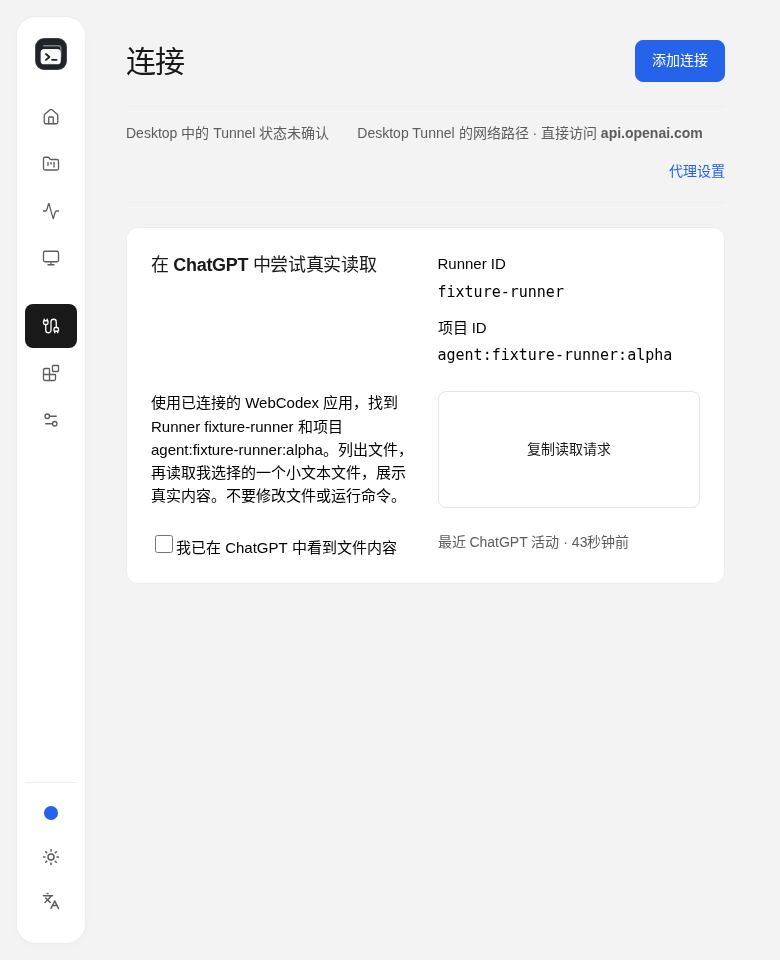
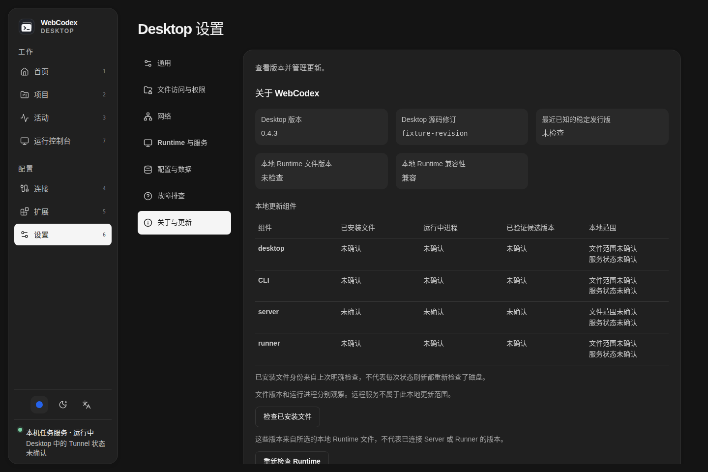

# Desktop solid-surface design

Desktop follows the approved Web visual direction from [PR #1173](https://github.com/yyjeqhc/webcodex/pull/1173), with a separate platform-neutral implementation tracked in [Issue #1174](https://github.com/yyjeqhc/webcodex/issues/1174). This branch does not depend on the pending Web branch. Desktop owns native lifecycle, connections, permissions and local configuration; their behavior is preserved.

## Layout contract

- Neutral light/dark canvas, opaque rounded content regions, weak separators and restrained shadows. The Desktop root explicitly opts into `styles/theme.css`; other renderers keep their own styling.
- A 224px navigation region becomes a 70px compact rail at 1100px. The native minimum window width remains 780px. Supplemental narrower fixture checks exercise clipping and translation behavior.
- All destinations share a 1440px maximum reading measure, 24px page/panel insets and section gaps (16/20px in supplemental narrow layouts). The main scroller reserves its scrollbar gutter to keep page headings stable.
- Selected primary/category navigation and activity tabs use black/white, inverted in dark mode. Entity selection retains a subtle full outline and restrained accent surface. No decorative selection rails remain.
- Three 36px Mantine controls provide preset/custom accent, System/Light/Dark cycling and a seven-language radio menu. The same source-owned accent/appearance component is used by the pending Web implementation. Popups use solid theme surfaces and library-owned focus/dismissal.
- Long values wrap within their label/value regions. Tables scroll inside their bounded containers; dialogs remain reachable in short windows. Native-control styling excludes Mantine composite inputs.

## Reproducing UI evidence

Run the [Desktop frontend checks](../../DESKTOP_DEVELOPMENT.md#fast-checks-before-opening-the-app), then:

```sh
node scripts/ui-smoke/desktop-soft-surfaces.mjs
```

The harness uses production Desktop assets and isolated loopback fixtures. It exercises all seven destinations, Activity tabs/details, Settings/Extensions categories, connection/plugin dialogs, long identities, preferences, keyboard focus, light/dark themes and English/Chinese at 1440/1280/1024/780/768/390px. Native Desktop has a 780px minimum; narrower browser fixtures are supplemental, not a claim of native mobile support. Reports and full screenshots are regenerated under ignored `artifacts/desktop-soft-surfaces/`.

Curated screenshots below contain synthetic fixture data only. Native Linux window verification and authenticated reads are recorded separately in the PR. Windows/macOS native execution, installers, reboot, real-model and destructive live workflows are outside this task's acceptance.

The older `desktop-workflow-layout.mjs` currently stops when it tries to edit
`#desktop-trace-mode`: its fixture lacks trace-edit authority and the control is
correctly disabled. The same failure was directly reproduced using a separately
built unmodified upstream/main checkout. This run is not passing evidence; the
focused matrix keeps authority intact and tests the current reachable controls.

## Fixture gallery






