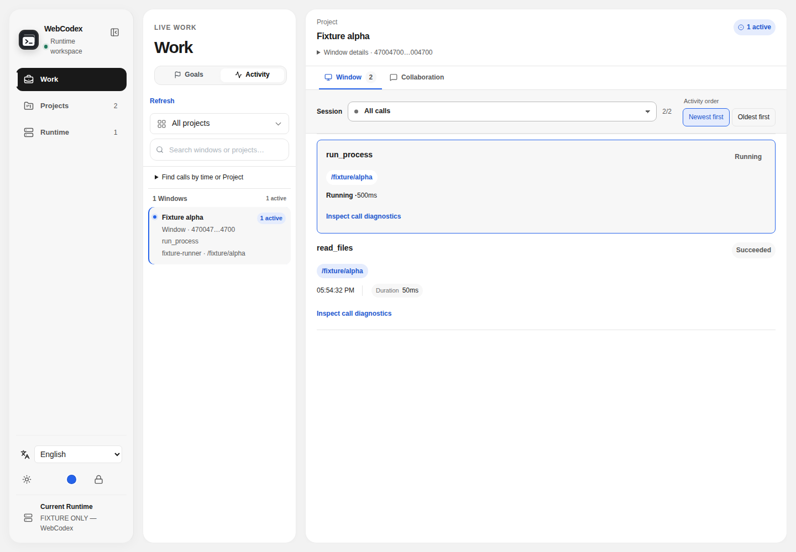
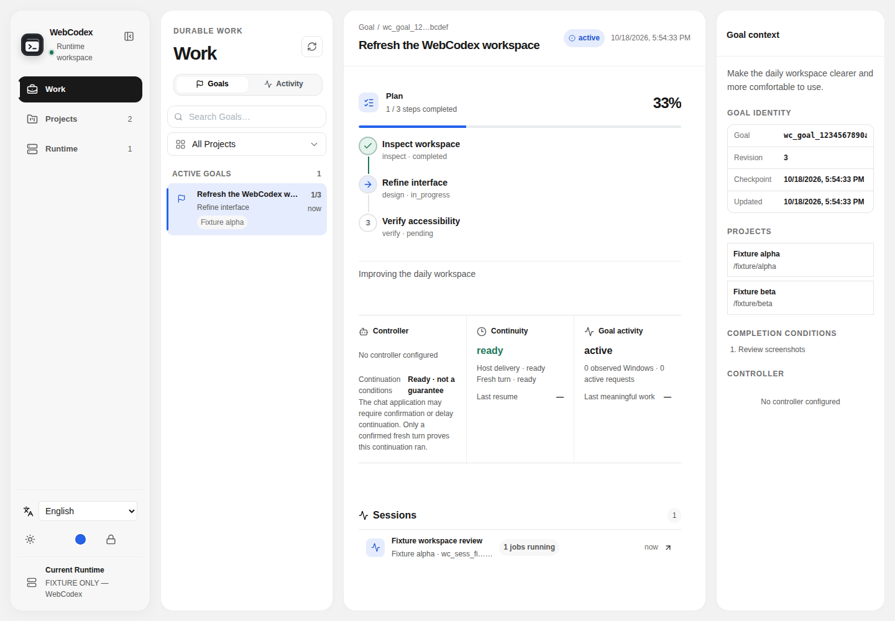
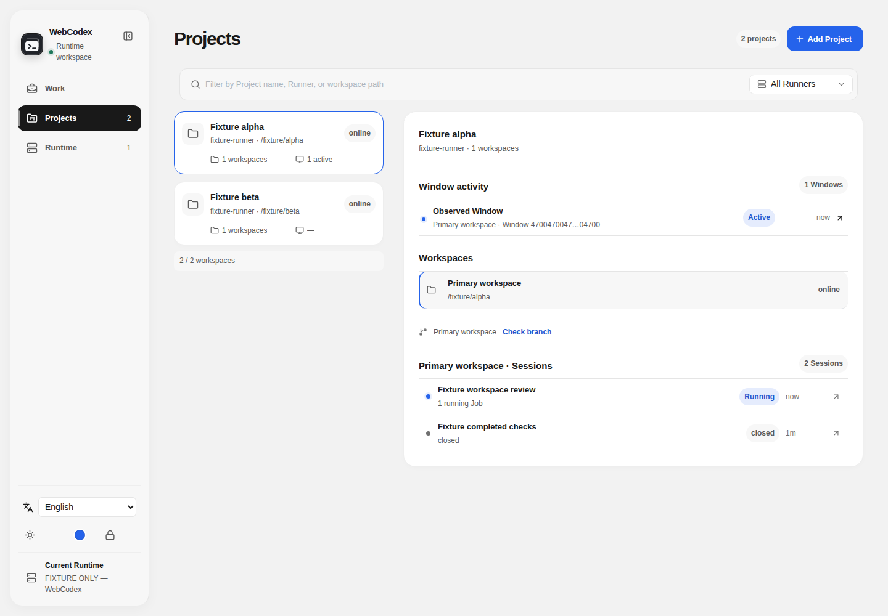
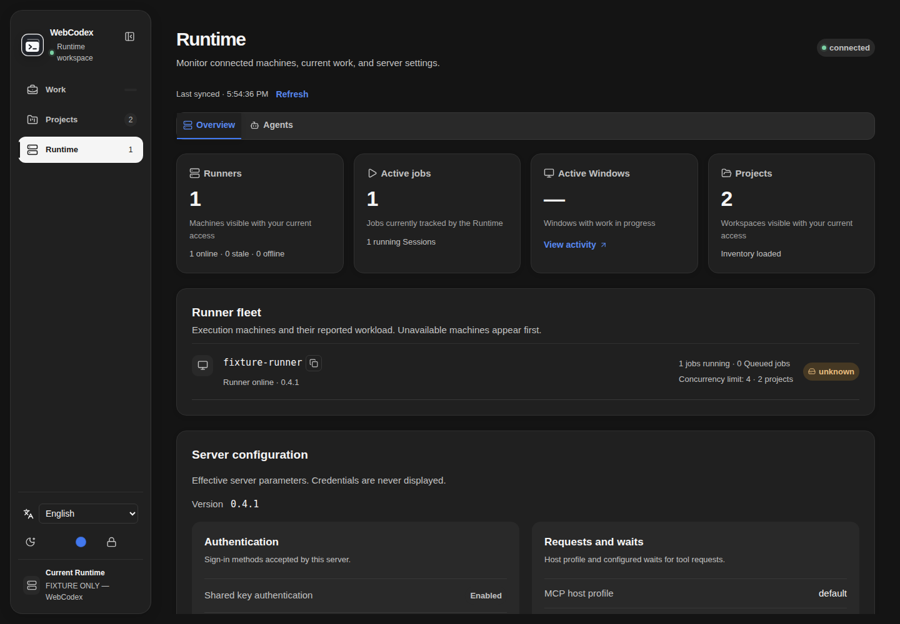
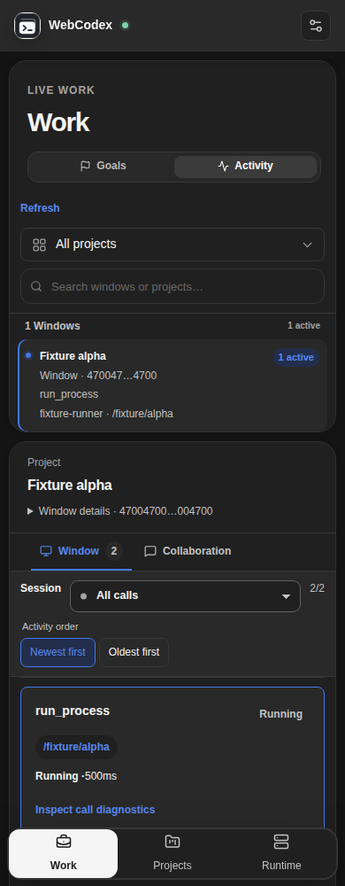
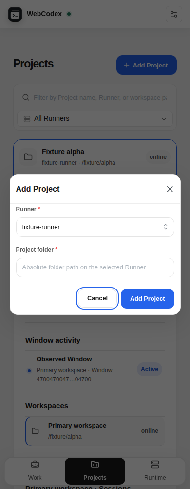
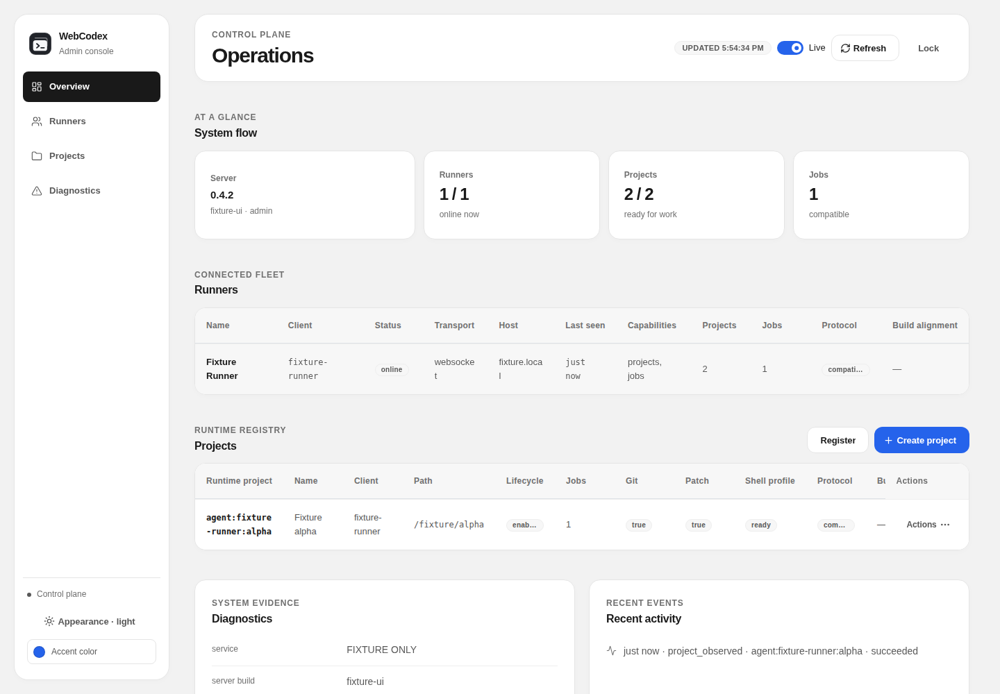
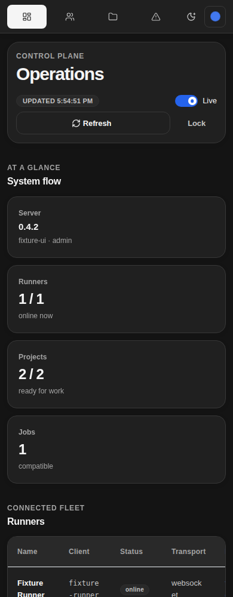

# Solid Web surface review

Runtime and Admin use opaque rounded surfaces, a neutral canvas and monochrome navigation, with blue as the default user-selectable accent. Desktop and MCP embedded surfaces remain outside this redesign. See the [interface review](../systematic-ui-review.md) and [Runtime design contract](../../../frontend/DESIGN.md).

## Reproducing the evidence

Build `frontend` and `apps/desktop`, then run `node scripts/ui-smoke/web-soft-surfaces.mjs`. The test covers both themes at 1440, 1280, 1024, 768 and 390 px; its screenshot and geometry report is regenerated under ignored `artifacts/web-soft-surfaces/`. All screenshots here use isolated fixtures, not private projects or live credentials. Additional focused checks cover Project selection, Agent interactions and exact Session navigation; see the [harness guide](../../../scripts/ui-smoke/README.md).

The existing broad UI smoke, legacy Session workflow smoke and Window workspace smoke have baseline failures on removed Desktop/Session controls and the activity-order default. They are not passing evidence for this revision. Real authenticated backend reads and authentication-boundary checks are reported separately in the PR; they do not establish another computer's network reachability, real-model behavior or native Desktop acceptance.

## Runtime

## Admin

