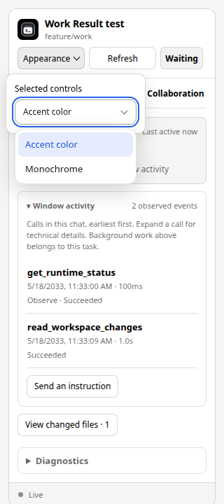
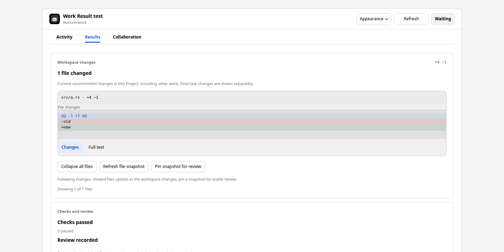

# Work Result 控件修复

[English](controls.md)

本次是已完成的 Work Result 改版之后的独立修复，记录于
[Issue #1253](https://github.com/yyjeqhc/webcodex/issues/1253)。用户截图显示
Appearance 弹层超出嵌入视口、头部控件尺寸不一致、标签焦点与选中状态混淆，
以及空结果区域仍展示过大的操作按钮。

Appearance 弹层现在按视口定位，限制左右边界，并在缩放或滚动时重新定位。
Escape 关闭弹层并将焦点还给入口；点击或聚焦外部也会关闭。挂载在文档根部的
下拉菜单仍属于弹层，选择本地偏好时不会提前关闭父弹层。销毁时关闭面板并移除
监听器。共享行为也应用于 Spreadsheet 的 Appearance；Workbench 保留现有的
Instance options 菜单。

Work Result 头部控件统一为 32px，触摸设备保持 44px 点击高度。窄卡片在空间允许时
将控件排列在独立的一行工具栏中，Refresh 为加载文案保留宽度。标签继续使用移动的
选中下划线；键盘焦点改用独立的内嵌虚线框，鼠标点击不会留下键盘焦点框。

Results 操作按内容确定宽度，并可一起换行。仅在文件展开时显示 Collapse；执行后
焦点返回文件入口。跟随中的空工作区隐藏 Pin 和跟随说明；已固定快照即使对应的当前
工作区变为空，仍保留 Follow changes。快照、身份和提交语义保持原有契约。

## 证据与复现

以下截图来自实际发布 HTML 和公开的合成数据，使用一次性的本地回环 MCP Host
测试夹具。它们不代表原生 ChatGPT/Codex Host、真实运行时或部署版本验收。
没有改动稳定或测试服务及其凭据。





```sh
node frontend/scripts/build-selection-motion.mjs --check
npm --prefix frontend run typecheck
node --test frontend/test/mcp-card-selection.test.mjs frontend/test/selection-motion-build.test.mjs src/mcp_tests/*.test.mjs
node scripts/ui-smoke/work-result-controls.mjs
node scripts/ui-smoke/mcp-workspaces.mjs
cargo test --locked -p webcodex --lib mcp::app_registry
cargo test --locked -p webcodex --lib work_result
cargo test --locked -p webcodex --lib retired_app_resources
```

控件脚本在 `artifacts/work-result-controls/` 写入截图和 `report.json`，覆盖浅色/深色、
320/390/800/1440px、内嵌/全屏、鼠标/键盘焦点、嵌套下拉选择、缩放、关闭、
空结果/有文件结果和触摸操作。Node 测试覆盖共享弹层销毁和固定快照保留；现有 MCP
浏览器矩阵覆盖正常动画、减少动态效果和强制颜色模式。

嵌入资源的缓存身份更新为 Work Result v36、Workbench v9、Spreadsheet v5，
旧身份继续退役。这些缓存版本不改变产品版本，也不表示已部署或刷新 Host 资源。
